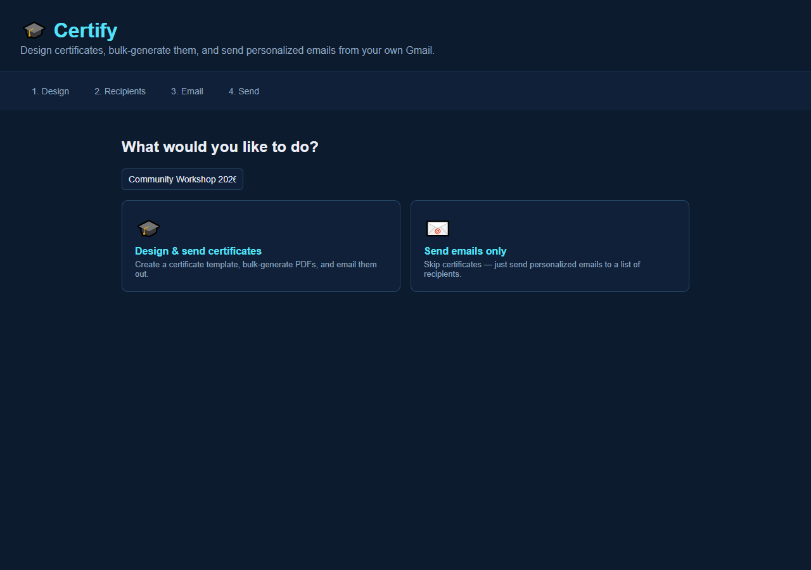
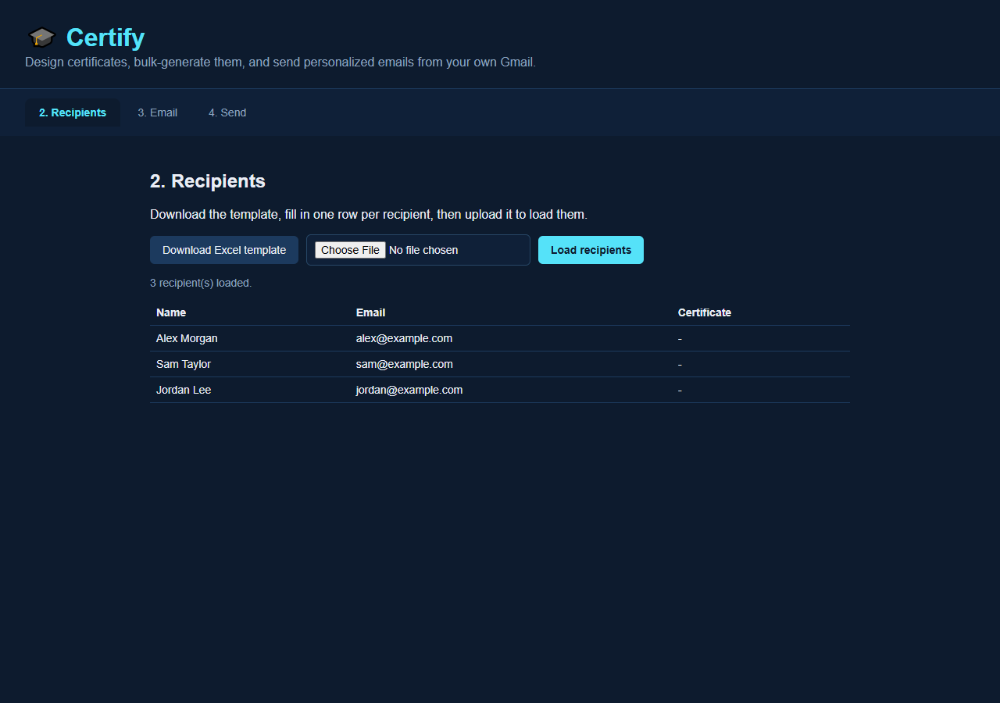

# Certify

**Create certificates and send personalized emails from your own Gmail account.**

Certify is a local web app for clubs, teams, and event organizers. Design a certificate, import participants from Excel, generate individual PDFs, and email each person a personalized message with the matching attachment. You can also send emails without certificates.



## Features

| Feature | What you can do |
| --- | --- |
| Two project modes | Design and send certificates, or send personalized emails without attachments. |
| Certificate designer | Upload a background, position variable fields, customize fonts, sizes, colors, bold, and italic, and upload custom TrueType fonts. |
| Bulk generation | Create a separate PDF certificate for each participant in your Excel sheet. |
| Visual email composer | Write in **Compose**, with fonts, sizes, bold, italic, underline, strike-through, colors, highlighting, lists, alignment, links, and right-to-left text. |
| HTML source mode | Switch to **HTML** to paste or edit an existing email template. |
| Personalized emails | Use placeholders such as `{{Name}}` and preview the message for each recipient. |
| Excel templates | Download a spreadsheet based on your saved certificate fields and email placeholders. |
| Rich content | Embed inline images, insert a LinkedIn link, or build a prompt to use manually in ChatGPT or Gemini. |
| Gmail sending | Connect your account with an App Password, without Google Cloud or OAuth setup. |
| Sending safeguards | Send a test, review results, and retry while skipping addresses logged as sent. Repeated addresses within a batch are deduplicated. |
| Email compatibility | Outgoing messages include both HTML and a plain-text alternative. |

## Requirements

- **Python 3.10 or newer**, with pip. Development checks were run on Python 3.12 on Windows.
- A modern browser, such as Edge, Chrome, or Firefox.
- **Git** to clone the repository, or download a ZIP instead.
- Internet access to install dependencies and send email.
- A Gmail account that supports **2-Step Verification and App Passwords**, if you want to send messages.

Frontend libraries are included locally. Certificate design and generation do not require a Gmail connection. No Node.js installation or separate frontend server is needed.

## Download From GitHub

### Option 1: Clone With Git

Open PowerShell or a terminal in the folder where you keep your projects:

```powershell
git clone https://github.com/AliArabi55/CertifyApp.git
cd CertifyApp
```

### Option 2: Download a ZIP

1. Open [AliArabi55/CertifyApp on GitHub](https://github.com/AliArabi55/CertifyApp).
2. Select **Code > Download ZIP**.
3. Extract the archive.
4. Open a terminal in the extracted folder containing `requirements.txt`.

## Run Locally

### Windows / PowerShell

From the project root, create a virtual environment and install dependencies:

```powershell
python -m venv venv
.\venv\Scripts\python.exe -m pip install -r requirements.txt
```

Start the local server:

```powershell
.\venv\Scripts\python.exe -m uvicorn app.main:app --app-dir backend --host 127.0.0.1 --port 8080
```

If Windows does not recognize `python`, try `py -3 -m venv venv` for the first command. These commands use the environment's interpreter directly, so PowerShell activation is not required.

### macOS / Linux

From the downloaded project folder:

```bash
python3 -m venv venv
./venv/bin/python -m pip install -r requirements.txt
./venv/bin/python -m uvicorn app.main:app --app-dir backend --host 127.0.0.1 --port 8080
```

Built-in certificate fonts depend on fonts installed on your operating system. Upload a suitable `.ttf` file when needed.

### Open the App

Visit **[http://localhost:8080](http://localhost:8080)**. Keep the terminal running while using Certify. Press **Ctrl+C** in that terminal to stop the server.

On later runs, only the server command is needed. In VS Code on Windows, you can also choose **Terminal > Run Task > Run Certify (8080)** after creating `venv` and installing dependencies.

The Python server serves both the interface and API. Do not open `frontend/index.html` directly.

## How to Use

### 1. Create a Project

Enter a project name and choose **Design & send certificates** for the full workflow, or **Send emails only** to skip certificate design and PDF generation.

### 2. Design Your Certificate

Skip this step in emails-only mode.

1. Choose an image and click **Upload certificate background**.
2. Click **+ Add variable field** and enter a name such as `Name` or `Role`.
3. Drag the field into position and use the side panel to adjust its appearance.
4. Upload a `.ttf` font if needed, then select it for the field.
5. Click **Save fields** before downloading the Excel template or generating certificates. Save again after changing the design.

Field names must be unique and use letters, numbers, or underscores. Custom fonts use the style in the uploaded font file; separate bold/italic toggles are disabled for them.

### 3. Write Your Email

Open **Email** before downloading the Excel template so it can include your message's placeholders.

1. Enter a subject, for example `Thank you, {{Name}}!`.
2. Use **Compose** to write and format your message visually, as you would in a regular email editor.
3. Add placeholders matching your spreadsheet headers, such as `{{Name}}`, `{{Role}}`, and `{{Event}}`.
4. Optionally choose an image and click **Upload & insert image**, or insert a LinkedIn link.
5. Click **Save draft** to store the message and detect its variables.


Use **HTML** for an existing template or HTML produced by an external AI tool. Paste the email body, preferably with inline styles. Switching existing HTML into **Compose** can simplify complex layouts; the app asks for confirmation first. Stay in HTML mode when preserving the original source matters.

Previewing and sending save the current subject and body first. This is not continuous background autosave: use **Save draft** before leaving the page and before downloading a template based on new placeholders.

The optional AI helper generates a prompt for you to copy manually. It does not contact ChatGPT or Gemini or write the message automatically.

### 4. Import Recipients and Generate PDFs

1. Open **Recipients** and click **Download Excel template**.
2. Fill in one row per person. Keep the header row and provide a valid `Email` for every recipient.
3. Fill in the columns used by your design and message. Placeholder names are case-sensitive: `{{Name}}` matches `Name`, not `name`.
4. Save as `.xlsx`, select the workbook in Certify, and click **Generate certificates** or **Load recipients**.
5. Review the table. In certificate mode, use **Download** to inspect each generated PDF.

Example spreadsheet:

| Email | Name | Role | Event |
| --- | --- | --- | --- |
| alex@example.com | Alex Morgan | Volunteer | Community Workshop |
| sam@example.com | Sam Taylor | Organizer | Community Workshop |



Blank optional cells are allowed, but each populated row needs an email address. Headers must be unique and nonempty; names beginning with `_` are reserved. CSV import is not supported. Duplicate participant names produce separate PDF files.

### 5. Preview, Test, and Send

1. Return to **Email**, choose a recipient, and click **Preview for this recipient**.
2. Check the personalized subject, message, images, and links. Inspect a generated PDF when using certificates.
3. Open **Send** and connect Gmail using the instructions below.
4. Choose a sample recipient row, enter **your own test address**, and click **Send test**. The row supplies the personalized content and attachment; the test address receives the email.
5. Check the delivered message in your mail client before clicking **Send to all recipients** and confirming.

Sending a test is strongly recommended, but the app does not enforce it. Keep the server running until sending finishes. Review results before retrying; addresses recorded as sent for that project are skipped. The log reduces duplicates but cannot guarantee exactly-once delivery if the process stops between sending and recording the result.

## Connect Gmail

1. Enable [2-Step Verification](https://myaccount.google.com/security) on your Google account.
2. Open [App Passwords](https://myaccount.google.com/apppasswords) and create a password named, for example, **Certify**.
3. In Certify's **Send** tab, enter your Gmail address and the generated App Password, then click **Connect Gmail**.

**Do not enter your normal Google account password.** Some managed accounts and security policies do not allow App Passwords. Consult your administrator if the option is unavailable.

Gmail applies sending quotas and abuse protections that vary by account and policy. The delay between messages does not bypass those limits. Use recipient lists you have permission to contact and check Google's current limits before large campaigns.

The LinkedIn link opens the URL supplied in your spreadsheet. It does not upload a certificate or guarantee a prefilled post; recipients must attach their certificate themselves.

## Local Data and Privacy

- Projects, uploaded images and fonts, PDFs, and send logs are stored under `backend/projects/<project_id>/`.
- Gmail credentials are stored **in plain text** in `config/.env`. Never share or commit this file. Use **Forget credentials** to remove saved Gmail credentials, and revoke the App Password through Google when no longer needed.
- Project data and credentials are excluded from Git by the ignore rules. Check any ZIP or backup before sharing: archive tools may still include ignored files.
- Run on a trusted machine with `--host 127.0.0.1`. Certify is a local, single-user tool without authentication, not a public hosting service. Do not expose its port to the internet.
- Uploaded assets are local, but sending uses Gmail. External URLs in email content may contact third-party services when viewed. Do not put passwords or private recipient data into external AI prompts.
- Saved project files persist on disk, but the current interface has no project browser or full resume workflow after a page reload.

## Troubleshooting

| Problem | What to check |
| --- | --- |
| `python` is not recognized | Install Python, reopen the terminal, or use the Windows `py` launcher. |
| `No module named uvicorn` | Install requirements using the same virtual environment interpreter used to run the server. |
| Port 8080 is busy | Stop your previous Certify instance, or change the port to `8081` and open `http://localhost:8081`. |
| The page does not open | Keep the server terminal running and check startup errors. Use the HTTP URL, not the HTML file. |
| Excel upload is rejected | Use a valid `.xlsx` file, unique headers, and valid addresses in the `Email` column. |
| New placeholders are missing from the template | Save the certificate fields and email draft, then download the template again. |
| A certificate font differs from the preview | Install the font or upload the matching `.ttf` file, then inspect a PDF before sending. |
| Gmail connection fails | Use an App Password and check account policies, internet access, and SMTP restrictions. |
| The delivered email looks different from the preview | Mail clients support different HTML and CSS features. Prefer simple formatting and test in the target mail client. |

## Built With

Python, FastAPI, Pillow, and openpyxl on the backend; HTML, CSS, JavaScript, Fabric.js, Quill, and DOMPurify on the frontend.

Screenshots use fictional sample recipients. No real email delivery is implied by the screenshots.

