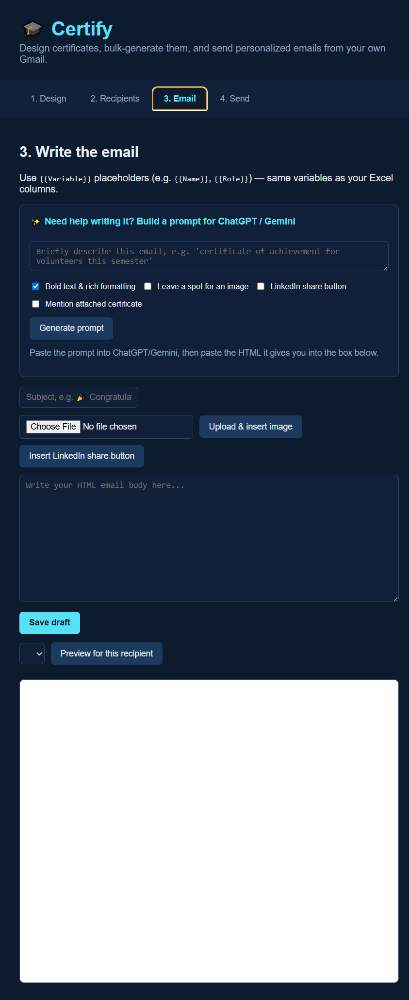

# Certify

تصميم شهادات وإرسال رسائل مخصصة من مكان واحد.

تطبيق محلي للأندية والفرق ومنظمي الفعاليات: صمّم شهادتك، ارفع بيانات المشاركين من Excel، ثم أرسل لكل شخص رسالته وشهادته عبر Gmail. ويمكنك إرسال الرسائل فقط دون شهادات.


## المميزات

| الميزة | ماذا تقدم لك؟ |
| --- | --- |
| مصمم الشهادات | خلفية من اختيارك، حقول قابلة للسحب، وتخصيص الخط والحجم واللون. |
| توليد جماعي | شهادة PDF منفصلة لكل مشارك من ملف Excel. |
| رسائل شخصية | استخدام متغيرات مثل `{{Name}}` مع معاينة الرسالة لكل مستلم. |
| محتوى غني | صور داخل الرسالة وزر مشاركة LinkedIn ومساعد لبناء طلب كتابة لـ ChatGPT أو Gemini. |
| إرسال عبر Gmail | ربط حسابك بكلمة مرور تطبيق، دون إعداد Google Cloud أو OAuth. |
| تجربة قبل الإرسال | إرسال اختباري أولًا، وسجل يتجاوز المستلمين المسجلين كمرسَل إليهم عند إعادة الإرسال. |

## التشغيل السريع

تحتاج إلى **Python 3.10 أو أحدث**. افتح PowerShell داخل مجلد المشروع وشغّل الأوامر التالية؛ إعداد البيئة وتثبيت المتطلبات مطلوبان في المرة الأولى فقط:

```powershell
python -m venv venv
.\venv\Scripts\python.exe -m pip install -r requirements.txt
.\venv\Scripts\python.exe -m uvicorn app.main:app --app-dir backend --host 127.0.0.1 --port 8080
```

افتح **[http://localhost:8080](http://localhost:8080)**. اترك نافذة التشغيل مفتوحة، واستخدم `Ctrl+C` لإيقاف الخادم.

في VS Code يمكنك أيضًا اختيار **Terminal > Run Task > Run Certify (8080)** بعد تثبيت المتطلبات. إذا كان المنفذ مشغولًا، أوقف نسخة التطبيق السابقة أو غيّر `8080` في الأمر إلى منفذ متاح وافتح العنوان الجديد.

## الاستخدام في 5 خطوات

1. **أنشئ مشروعًا:** اكتب اسمه واختر الشهادات والرسائل، أو الرسائل فقط.
2. **صمّم الشهادة:** ارفع صورة الخلفية، أضف حقولًا مثل `Name`، ثم اضغط **Save fields**. تجاوز هذه الخطوة في وضع الرسائل فقط.
3. **جهّز الرسالة والبيانات:** اكتب عنوان الرسالة ومحتوى HTML ومتغيراته في **Email** واحفظ المسودة. ارجع إلى **Recipients** لتنزيل قالب Excel، واملأ صفًا لكل شخص مع عمود `Email`، ثم ارفعه لتوليد الشهادات أو تحميل المستلمين. تحديد المتغيرات قبل تنزيل القالب يضمن ظهور أعمدتها.
4. **راجع المعاينة:** افتح **Email** واختر مستلمًا ثم **Preview for this recipient** للتأكد من استبدال المتغيرات.
5. **اختبر ثم أرسل:** اربط Gmail في **Send**، أرسل رسالة اختبار لنفسك، وراجعها قبل **Send to all recipients**.



## ربط Gmail وحماية بياناتك

- فعّل [التحقق بخطوتين](https://myaccount.google.com/security)، ثم أنشئ [كلمة مرور تطبيق](https://myaccount.google.com/apppasswords) والصقها داخل التطبيق مع عنوان Gmail. لا تستخدم كلمة مرور حسابك العادية. قد تمنع سياسات بعض الحسابات إنشاء كلمات مرور التطبيقات.
- تُحفظ بيانات المشاريع والشهادات محليًا داخل `backend/projects/`. وتُحفظ بيانات Gmail بنص صريح في `config/.env`؛ لا تشارك هذا الملف أو تضفه إلى Git. استخدم **Forget credentials** لحذفها محليًا.
- يتصل التطبيق بخدمات خارجية لإرسال البريد وتحميل مكتبة الواجهة. وإذا استخدمت مساعد ChatGPT أو Gemini، فلا تنسخ إليه بيانات المستلمين أو كلمات المرور.
- تخضع الرسائل لحدود Gmail وسياسات الحساب. زر LinkedIn لا يرفع الشهادة تلقائيًا؛ يرفقها المستلم بنفسه.

<details>
<summary>English documentation and additional details</summary>

## Certificate & Mail-Merge Web App

A local, self-hosted, **plug & play** web app to:
1. (Optional) Design a certificate (drag-and-drop text fields onto your own background image),
2. Bulk-generate certificates from an Excel sheet, and
3. Send personalized emails (with `{{Variable}}` placeholders) from **your own Gmail account**, with the matching certificate auto-attached.

Runs locally without cloud hosting, a Google Cloud project, or OAuth setup. Sending email uses Gmail, and the frontend loads a library from a public CDN.

> This repo is generic/reusable for any club or organization (built with GitHub Campus Experts in mind). It ships with no hardcoded branding — everything (the certificate design, the variables, the email copy) is defined by you inside the app.

## Features
- **Two modes** — pick "Design & send certificates" for the full flow, or "Send emails only" to skip certificates entirely and just mail-merge a recipient list.
- **Certificate designer** — upload a background image, drag text fields onto it, set font/size/color/bold/italic per field, upload custom `.ttf` fonts.
- **Auto-generated Excel template** — download a blank sheet with exactly the columns you need (your certificate fields + any `{{Variable}}` used in your email + `Email`).
- **Bulk certificate generation** — upload the filled sheet, get one PDF per recipient.
- **Email composer** — write your subject/HTML with `{{Name}}`, `{{Role}}`, etc.; variables are auto-detected; per-recipient live preview.
  - **AI drafting helper** — tick a few checkboxes (bold formatting, image spot, LinkedIn button, certificate mention), describe the email in one line, and get a ready-to-paste prompt for ChatGPT/Gemini that writes the HTML for you.
  - **Insert images** — upload an image and it's embedded inline (via CID, not a flaky `data:` URI) and shown correctly in both the preview and the real email.
  - **Insert a LinkedIn share button** — one click adds a styled button linking to a `{{LinkedIn_Share_Link}}` column you provide. Note: LinkedIn's link parameters don't support auto-attaching a file, so the recipient still has to attach their certificate manually on LinkedIn — this is a platform limitation, not something this app can work around.
- **Your own Gmail, via an App Password** — no Google Cloud project, no OAuth consent screens, no verification wait times. Enter your Gmail address + a 16-character App Password once; it's saved locally in `config/.env`.
- **Safe send flow** — mandatory test send first, then send-to-all with a resumable log (re-running skips anyone already marked "sent").

## Prerequisites
- Python 3.10+
- A Gmail account with 2-Step Verification enabled (needed to generate an App Password — see below)

## Installation
```powershell
git clone <this-repo-url> CertifyApp
cd CertifyApp
python -m venv venv
venv\Scripts\Activate.ps1
pip install -r requirements.txt
```

## One-time: get a Gmail App Password (3 steps, ~1 minute)
This app sends email over SMTP using an **App Password** — a 16-character code Google generates for you, completely separate from your real password. No Google Cloud project, no API enablement, no consent screen.

1. Turn on **2-Step Verification** on your Google account, if it isn't already: https://myaccount.google.com/security
2. Go to https://myaccount.google.com/apppasswords, enter a name for it (e.g. "Certify"), and click **Create**.
3. Copy the 16-character password Google shows you (spaces don't matter) — paste it into the app's **Connect Gmail** step along with your Gmail address. It's saved locally to `config/.env` so you won't need to re-enter it next time.

## Running the app
```powershell
cd backend
uvicorn app.main:app --reload --host 127.0.0.1 --port 8080
```
Open http://localhost:8080 in your browser. From VS Code, you can also run the **Run Certify (8080)** task after installing dependencies in `venv`.

## Usage walkthrough
1. **Choose a mode** — name your project, then pick "Design & send certificates" or "Send emails only".
2. **Design** *(certificates mode only)* — upload your certificate background image, click "+ Add variable field" for each piece of text you want personalized (e.g. `Name`, `Role`), drag it into position, and adjust font/size/color/bold/italic in the side panel. Click **Save fields**.
3. **Recipients** — click **Download Excel template** (columns match your fields + any email variables + `Email`), fill in one row per recipient, then upload it and click **Generate certificates** (or **Load recipients** in emails-only mode).
4. **Email** — write your subject and HTML body using `{{Name}}`-style placeholders, or use the AI prompt helper to get a draft from ChatGPT/Gemini. Insert images or a LinkedIn button with one click. Save the draft, then preview it for any recipient.
5. **Send** — enter your Gmail address + App Password and click **Connect Gmail** (first time only), send a **test** to yourself, check it, then **Send to all recipients**. The send log lets you safely re-run the app later — already-sent recipients are skipped.

## Data storage
Everything for a project lives under `backend/projects/<project_id>/`: the background image, `project.json` (fields + email draft), uploaded fonts, uploaded email images, generated certificates, and the send log. This folder is gitignored — it's your data, not source code.

## Gmail sending limits
Gmail enforces daily sending caps: ~500 emails/day for a personal `@gmail.com` account, ~2,000/day for Google Workspace accounts. The app waits a couple of seconds between sends to stay well under rate limits, but very large recipient lists may need to be split across days.

## Security notes
- `config/.env` contains your Gmail address and App Password in plain text — never commit or share it (already gitignored). Treat the App Password as a sensitive account credential; you can revoke it anytime from https://myaccount.google.com/apppasswords without changing your real password. Use **Forget credentials** in the app to delete it locally.
- Treat this like any locally-saved credential: don't run the app on a shared/public machine, and revoke the App Password if the machine is ever compromised.

## Roadmap / ideas not yet implemented
- Plain-text alternative part alongside the HTML email (better deliverability).
- A send-log/history dashboard across projects.
- Multiple certificate templates per project.
- CSV import alongside Excel.
- "Re-run this campaign" export/reuse of a saved project for future events.

</details>

